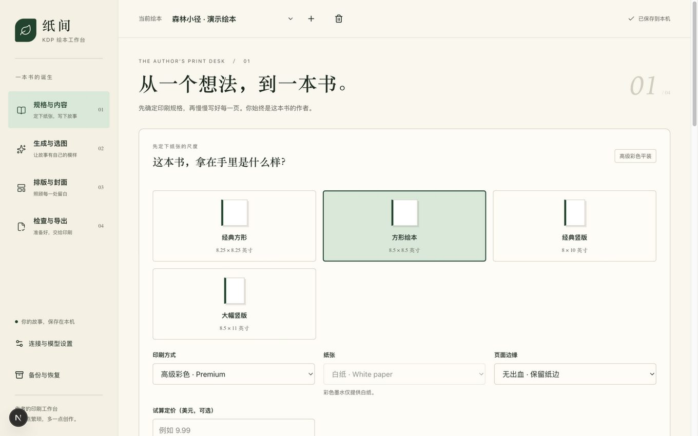

# 绘本工坊 · KDP Helper

[](https://github.com/anmutu/kdp-helper/actions/workflows/ci.yml)
[](LICENSE)

官网 / Website：**https://anmutu.github.io/kdp-helper/**

给作者自己使用的本地绘本工作台。先确认来自 KDP 官方文档的出版规格，再整理页面、生图或导入素材、挑选排版，最后导出内页 PDF 和完整封面 PDF。

没有注册、会员、收费平台或云同步。外部模型调用仍可能按你的服务商规则收费。

## English

**KDP Helper** is a local-first, single-author workbench for making print-ready children's picture books for [Amazon KDP](https://kdp.amazon.com). Website: **https://anmutu.github.io/kdp-helper/**. It walks you through the whole loop: pick a verified print spec (trim / ink / paper / bleed) → write pages (manually, from a template, or with a text model) → generate or import illustrations → compare and pick candidates → lay out text and cover → export a validated `interior.pdf` + wraparound `cover.pdf` + upload notes.

Why authors like it:

- **Spec-first, never guess.** Page ranges, spine width, bleed geometry, margins and 300-DPI pixel requirements come from official KDP documentation with checked dates and source links (`src/domain/print-spec.ts`). Black & white (white/cream paper) and premium/standard color are supported across four trim sizes.
- **Money guardrails.** It refuses paid generation calls when requested pixels can't print, pauses a batch as soon as a low-resolution image comes back, never auto-retries uncertain billed requests, and estimates per-book printing cost and US royalty (including the $9.98/$9.99 royalty-rate breakpoint).
- **Real files, real checks.** Exports are actual PDFs with an embedded CJK font, crop-mark free, CMYK-flattened images; odd page counts, missing glyphs, text overflow, low DPI and placeholder text block the production export.
- **Local and private.** Everything lives on your machine (`data/`); your API key never leaves the local settings file. Works fully offline if you import your own images.

```bash
npm install
npm run dev   # http://127.0.0.1:3210 — local access only
```

License: code under [MIT](LICENSE); the bundled Noto Sans CJK SC font under its own [OFL license](assets/fonts/OFL.txt). This project is not affiliated with Amazon; always verify current rules against official KDP documentation before printing.



## 启动

需要 Node.js 22.14 或更新的兼容版本；本次开发验证环境为 Node.js 24。

```bash
npm install
npm run dev
```

浏览器打开 `http://127.0.0.1:3210`。应用只监听本机，不要把它部署成公开服务。

正式构建运行：

```bash
npm run build
npm start
```

## 建议的第一次使用顺序

1. 新建一本书。选开本、黑白/高级彩色/标准彩色、纸张与是否出血，查看页数与图片像素要求；阅读官方来源后确认规格。
2. 填写主题和页面内容。可以手动添加页面、载入明确标为示例的 A–Z 页面清单，或让文字模型按“目标页数”（偶数）起草草稿；示例与草稿中的版权占位文字必须替换。
3. 在设置中填写 coderplan-ai 的服务地址、API Key、生图模型和实际支持的输出尺寸；如果更换或撤销密钥，可在设置中明确清除本机保存的 Key。文字模型可不配置；留空时手工写文案即可。
4. 建议先选择“仅低清试画”，用少量页面验证画风和接口。低清试画不能直接当作可印刷素材。
5. 确定画风后，把请求尺寸调整到满足规格的水平，再生成印刷候选。工具会在调用前阻止明显不足的请求尺寸，返回图片仍按实际像素重新检查。
6. 每页从候选中选择图片；不满意只重画该页。也可以完全不配 Key，直接导入已有图片。
7. 调整文字、字号、图片位置与裁切，完成封面书名、署名、简介和选图。
8. 先导出草稿检查实际 PDF，再处理检查列表中的错误，完成作者人工确认后导出正式文件。
9. 到 KDP 手工上传内页与封面，按说明选择一致的出版参数，完成 Print Previewer 和 AI 内容申报。建议正式发行前订购样书。

## 为什么先定规格

规则核对日期：2026-09-17。当前支持经过核对的黑白与彩色平装、四种成品尺寸；黑白可选白纸或米色纸，彩色墨水仅提供白纸。官方另列黑白 groundwood 纸，但帮助文档未给出其书脊系数，为避免猜测暂不提供。不是 KDP 全部开本的镜像，也不支持精装或 Kindle 电子书。

| 开本（英寸） | 黑白 · 白纸 | 黑白 · 米色纸 | 标准彩色 · 白纸 | 高级彩色 · 白纸 |
| ------------ | ----------- | ------------- | --------------- | --------------- |
| 8.25 × 8.25  | 24–800      | 24–750        | 72–600          | 24–800          |
| 8.5 × 8.5    | 24–590      | 24–550        | 72–600          | 24–590          |
| 8 × 10       | 24–828      | 24–776        | 72–600          | 24–828          |
| 8.5 × 11     | 24–590      | 24–550        | 72–600          | 24–590          |

- 出血内页宽加 0.125 英寸、高加 0.25 英寸；只加在上下和外侧，左右页方向不同。
- 封面单独计算，包含封底、书脊、正面及外缘出血；黑白白纸、黑白米色纸、标准彩色、高级彩色使用各自的书脊系数。
- 图片最低像素根据真实放置区域和裁切计算，不能通过修改 DPI 元数据来“补清晰度”。
- 内页不足最低页数、奇数页、未确认选图、低分辨率、文字溢出、缺字和占位文案都会阻止正式导出；草稿仍可导出检查。
- 改变规格会撤销规格确认；改变画风或画面要求会要求重新确认选图，不会自动花钱重画。

来源：[内页提交规范](https://kdp.amazon.com/en_US/help/topic/G201857950)、[封面规范](https://kdp.amazon.com/en_US/help/topic/G201953020)、[官方封面计算器](https://kdp.amazon.com/cover-calculator)。若 Amazon 更新规则，需先核对并更新 `src/domain/print-spec.ts` 与测试，不要让 AI 临时猜测规则。

## 生图和费用边界

- 默认服务地址为 `https://api.coderplan.ai/v1`。模型、尺寸、参考图能力必须按你实际开通的服务配置；工具不保证任意模型都支持任意尺寸。
- 默认尺寸 `1024x1024` 主要用于试画，通常不足以铺满印刷页面。设置弹窗会按当前绘本的图文分区、整页与封面版式，预估请求尺寸的有效 DPI；不足 300 DPI 时只能低清试画。没有可信价格配置时，界面明确显示费用未知，而不是显示虚假的免费或估价。
- 参考图需要模型支持 `/images/edits`；未确认能力时不会偷偷忽略参考图。
- 图片逐张请求并保存，批量任务可停止后续请求。已发出的请求不能保证取消或退款。
- 非试画任务若实际返回图片不足 300 DPI，会保留该候选并立即暂停后续请求，不让整个批次继续花费。每张发送前也会重新检查当前版式条件。
- 同一次生成提交带持久化操作标识，响应丢失后的相同提交不会再创建收费任务；作者明确再次生成才创建新操作。
- 超时、连接中断、结果下载失败时，不自动重复发起可能收费的请求。先检查服务商控制台，必要时取回图片并手动导入。
- 应用重启不会自动重发未完成任务。此工具应作为持续运行的本机 Node 应用使用，不面向无状态 serverless 部署。

## 本地文件和隐私

默认存储目录是项目下的 `data/`，也可通过 `KDP_DATA_DIR` 指定其他本机目录。

| 目录/文件            | 内容                                           |
| -------------------- | ---------------------------------------------- |
| `data/projects/`     | 每本书的内容、规格、候选元信息与选图。         |
| `data/assets/`       | 本地保存的候选图片及来源信息。                 |
| `data/exports/`      | 不覆盖旧版本的出版文件与对应内容快照。         |
| `data/jobs.json`     | 生成任务记录。                                 |
| `data/settings.json` | 服务配置与 API Key，权限限制为当前用户可读写。 |

**API Key 在本地配置文件中保存，不是系统钥匙串加密存储。** 不把 `settings.json` 上传、提交 Git 或分享给别人；不要在多人不可信电脑上使用。浏览器只接收“是否已配置 Key”，导出文件不含 Key。更换服务或结束项目时，建议在设置中清除旧 Key。

可备份 `projects/`、`assets/` 和 `exports/`；不要只备份 PDF，因为 PDF 不能代替可编辑项目。自动保存不是异地备份。

单个项目文件损坏不会阻止其他绘本打开。工作台会列出无法读取的文件，原文件不会被自动修改或删除；请先保留原文件，再检查或从备份恢复。可以通过侧栏“备份与恢复”导入之前保存的 ZIP，新建恢复副本；手工修复原文件后刷新页面也可重新载入。

删除候选与复用素材使用同一项目的串行保护。已被其他页面、封面或参考图引用的图片会保留；如果另一操作已先删除最后一个引用及原图，复用会明确失败，不会写入指向不存在图片的选图记录。不要同时启动多个应用进程操作同一数据目录。

## 备份与恢复

1. 打开绘本，点击侧栏“备份与恢复”→“下载当前绘本备份”。工具先保存当前修改，再下载 `.kdp.zip`。
2. ZIP 包含可编辑项目、全部仍被项目引用的候选原图和参考图、已完成导出的 PDF/说明/快照。不会包含 API Key、服务设置、未完成任务或请求幂等记录。
3. 恢复时选择备份并确认。工具先检查格式、文件清单、SHA-256 校验和、图片尺寸及可解码性，再新建“恢复副本”。原书和本机服务配置不变，规格与选图需要重新确认，不会自动调用模型。
4. 下载后确认文件已保存，并复制到其他可靠位置。ZIP **不加密**，只导入可信来源的备份，不要把未发表内容随意分享。

当前只接受本工具的版本 1、未重新压缩的 ZIP 格式。每次上限 **256 MiB / 4096 个文件**，单文件上限 128 MiB、JSON 上限 16 MiB。超过限制或存在损坏历史时会明确停止，不会偷偷省略素材；请改为手工备份完整数据目录中的 `projects/`、`assets/`、`exports/`，不要分享 `settings.json`。

恢复到新项目的历史 PDF 仍属于旧快照，不意味着恢复后的内容已经重新通过检查。恢复不会覆盖原书，也不会恢复旧的生图任务。实现边界见 `docs/backup-and-history.md`。

## 导出内容

- `interior.pdf`：按顺序的单页内页，字体嵌入；没有编辑辅助线。
- `cover.pdf`：封底、书脊、正面的完整展开封面，留出条码区域，首版不印书脊文字。
- `upload-notes.txt`：本次规格、页数、规则版本、颜色处理与上传检查提示。

封面还未完成时，可以选择“仅导出内页”；此时只导出内页和说明，并明确标记整本出版文件尚未齐全。

第四步的“导出历史”直接读取本机已完成版本，切换步骤或重启后仍可下载。历史区分草稿/正式、完整/仅内页及当前/旧快照；损坏版本单独提示，导出未完成的临时目录不会显示为成功版本。

图片在导出时扁平化并转换为 CMYK JPEG。黑白内页的插图先转灰度；封面插图保留原色，不随内页墨水设置转灰度。文字使用嵌入的 Noto 字体。此工具不提供 PDF/X 认证，不保证屏幕颜色等于纸质印刷，也不代替 KDP 审核。草稿带可见标记，不要上传草稿。

服务端发现文字溢出或字体缺字时，会返回具体内页页码或封面位置，并显示在导出检查列表中。点击“去处理”可打开对应页面的排版或封面选项；修改内容后需重新检查。客户端检查通过不代表服务端排版检查已通过。

字体采用 Noto Sans CJK SC，许可证随文件位于 `assets/fonts/OFL.txt`；来源为 [Noto CJK](https://github.com/notofonts/noto-cjk)。不要用没有印刷/嵌入授权的替代字体。

## 开发与检查

```bash
npm test
npm run typecheck
npm run lint
npm run build
```

- `src/domain/`：前后端共用的规格与书籍模型。
- `src/server/`：文件保存、服务商调用、任务和 PDF 生成。
- `src/app/api/`：本机请求边界与瘦 API 路由。
- `src/components/`：作者工作台。
- `tests/`：规则、持久化、费用保护、实际 PDF 和离线整书流程测试。

需求与调研记录见 `docs/requirements.md`、`docs/research/`。实施与验证记录见 `docs/implementation-plan.md`、`docs/verification.md`。
