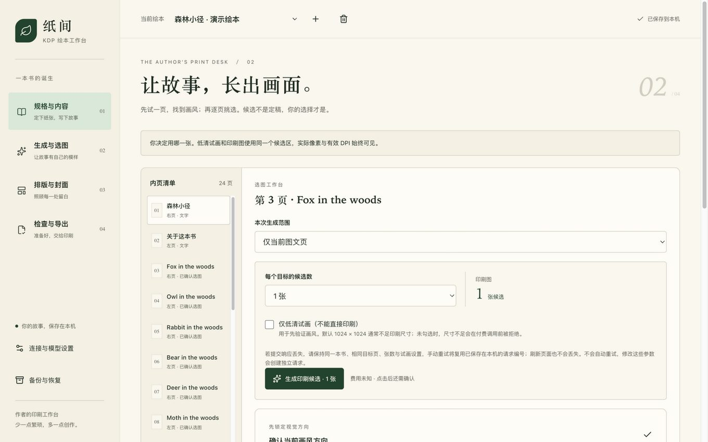
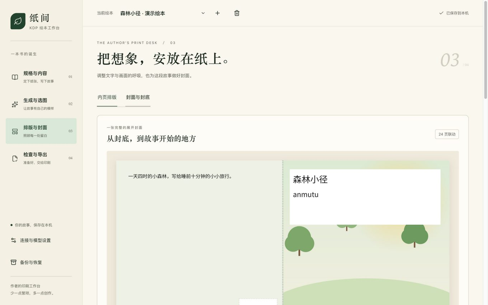
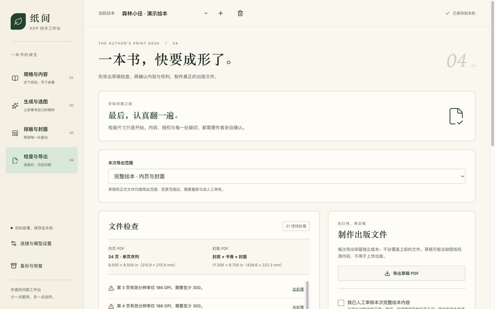

# 纸间 · KDP Helper 使用手册

版本：v0.1.0 对应手册（2026-10）。本手册面向操作者（作者本人或受托管理人），按做一本书的真实顺序讲解每一步**怎么做**与**为什么这么设计**。界面为中文；阅读本册不需要印刷知识。

> 全册的三个原则，先记住，后面所有设计都能理解：
>
> 1. **规格先行**：印刷规则来自 KDP 官方文档（每条都标注来源与核对日期），页数、尺寸、书脊、图片清晰度全部由工具算好并拦截错误，不靠人记。
> 2. **你做所有决定**：工具从不自动帮你选图、自动补页、自动上传。每个要花钱或影响成书的动作都由你确认。
> 3. **钱不白花**：任何可能付费的图片生成，工具在调用前检查"这个尺寸印得出来吗"，返回后复核真实像素，不对就拦下整批。

---

## 目录

1. [这是什么，给谁用](#1-这是什么给谁用)
2. [安装与启动](#2-安装与启动)
3. [界面总览：四个步骤](#3-界面总览四个步骤)
4. [第一步 · 规格与内容](#4-第一步--规格与内容)
5. [第二步 · 生成与选图](#5-第二步--生成与选图)
6. [第三步 · 排版与封面](#6-第三步--排版与封面)
7. [第四步 · 检查与导出](#7-第四步--检查与导出)
8. [备份与恢复](#8-备份与恢复)
9. [连接与模型设置](#9-连接与模型设置)
10. [上传 KDP（工具之外的事）](#10-上传-kdp工具之外的事)
11. [常见问题](#11-常见问题)
12. [安全边界与注意事项](#12-安全边界与注意事项)

---

## 1. 这是什么，给谁用

**纸间 · KDP Helper** 是一个跑在你自己电脑上的绘本制作工作台，帮你完成从想法到"可上传亚马逊 KDP 的出版文件"的全过程：

```
定印刷规格 → 写每页文字 → 生成/导入插画 → 挑选与排版 → 做封面 → 导出内页 PDF + 封面 PDF
```

**为什么会有这个工具**：做 KDP 绘本最容易翻车的不是画画，而是印刷规格——选了标准彩色才发现最少要 72 页；图在屏幕上清楚、印出来只有 120 DPI；书脊宽度用错系数封面就作废。这些规则散在 KDP 四个帮助页里。这个工具把它们变成"选择题"：你选，它算，错了他拦。

**给谁用**：独立作者本人，或受作者委托操作的人（下称"操作者"）。单机单人使用，没有账号系统。

**它不做的事**（同样重要）：

- 不替你上传、不替你点发布——KDP 账号操作永远在你手里；
- 不自动帮你选图、不自动补页——所有影响成书的决定都要人确认；
- 不做在线服务——数据全在本机（原因见第 12 节）。

## 2. 安装与启动

### 2.1 需要什么

| 项目    | 要求                                                             |
| ------- | ---------------------------------------------------------------- |
| 电脑    | macOS（开发验证环境）、Linux 应当可用；Windows 暂未测试          |
| Node.js | 24（22.14 以上兼容）                                             |
| 网络    | 仅在调用你自己的 AI 生图服务时需要；不配也能用（纯手工导入图片） |

### 2.2 启动方式（三选一）

- **双击启动器**（推荐）：项目文件夹里的 `启动绘本工坊.command`，双击后自动启动并打开浏览器；
- **官网入口**：打开官网 https://anmutu.github.io/kdp-helper/ ，点"打开工作台"按钮（工具在运行时直接进入；没运行会提示并给出启动步骤）；
- **命令行**：`npm install` 后 `npm run dev`（开发模式）或 `npm run build && npm start`（生产模式）。

启动后浏览器访问 **http://127.0.0.1:3210**。把这个地址收藏到书签即可。

> **为什么是 127.0.0.1**：这个地址只有你自己电脑能访问。工具刻意不监听外部网络——你的书稿和 API Key 不经过任何服务器。电脑重启后需重新双击启动器。

### 2.3 数据存在哪里

所有内容存在项目下的 `data/` 目录（可用环境变量 `KDP_DATA_DIR` 改位置）：

| 位置                 | 内容                                     |
| -------------------- | ---------------------------------------- |
| `data/projects/`     | 每本书的全部内容（规格、文字、选图）     |
| `data/assets/`       | 候选插画原图与来源记录                   |
| `data/exports/`      | 历次导出的 PDF 与说明                    |
| `data/settings.json` | 服务配置与 API Key（**不要分享此文件**） |

**备份提醒**：重要书稿请定期用第 8 节的"备份与恢复"导出 `.kdp.zip` 并存到其他位置；只备份 PDF 不够，PDF 不能再编辑。

## 3. 界面总览：四个步骤

左侧栏是制作一本书的四个阶段，可随时点换：

| 步骤 | 名称       | 干什么                         |
| ---- | ---------- | ------------------------------ |
| 01   | 规格与内容 | 定开本/墨水/纸张，写每页文字   |
| 02   | 生成与选图 | 为每页生成或导入插画，挑选确认 |
| 03   | 排版与封面 | 调字号/颜色/裁切，做完整封面   |
| 04   | 检查与导出 | 查错、导出可上传的 PDF         |

**为什么是这个顺序**：后面每一步的计算都依赖第一步的规格——书脊宽度由"页数×墨水纸张系数"算出；每页插画需要的像素由"开本×版式"算出；印刷成本和版税由"墨水×页数×定价"算出。规格不先定，后面全是空谈。反过来，**中途改规格，后面会连锁失效**（已确认的选图要重新确认），这是有意的——防止你带着旧参数的图和新参数的书去印刷。

顶栏从左到右：切换绘本（书架）、新建 `+`、删除（垃圾桶图标，带确认）、右侧保存状态（"已保存到本机"表示安全；显示"等待自动保存/正在保存"时别关浏览器）。

## 4. 第一步 · 规格与内容


### 4.1 选规格（页面最上方的面板）

四个选择，每个都会实时联动下方"规格单"：

**① 开本（成品尺寸）**——四种预设：

| 开本                 | 特点                 |
| -------------------- | -------------------- |
| 8.25 × 8.25 经典方形 | 绘本最常用方开本     |
| 8.5 × 8.5 方形绘本   | 略大，页数上限略低   |
| 8 × 10 经典竖版      | 竖版故事书常见       |
| 8.5 × 11 大幅竖版    | 大开本，适合低幼大图 |

**② 印刷方式（墨水）**——决定单册成本的最主要因素（美区估算）：

| 墨水     | 特点                           | 26 页示例成本    |
| -------- | ------------------------------ | ---------------- |
| 黑白     | 白纸或米色纸；最便宜           | 约 $2.84/册      |
| 高级彩色 | 色彩最好；绘本主流选择         | 约 $4.20/册      |
| 标准彩色 | **最少 72 页起**，短绘本不可用 | 72 页约 $3.90/册 |

**③ 纸张**——只有黑白可选米色纸（彩色墨水仅白纸，KDP 规则如此）。

**④ 页面边缘（出血）**——"画面到边"（出血）适合整页大图，图必须超出成品边 0.125 英寸裁掉；"保留纸边"（不出血）边缘留白，构图更从容。整本书统一，不能混。

> **为什么改规格后要重新确认**：规格变了，页数范围、书脊、每页需要的图片像素全变。工具会自动取消你勾过的"我已核对规格"，逼你重新看一眼规格单——这一步是防止"改了开本忘了图不够大"这类事故的最后一道闸。

### 4.2 读懂规格单

选完规格，面板中部的规格单给出全部硬数字：成品尺寸（英寸+毫米）、内页页数范围、图片最低 300 DPI、单册印刷成本（美区估算）、可选的**试算定价与版税**。

> **$9.98 与 $9.99 的秘密**：美区 KDP 平装定价 ≤$9.98 版税率 50%，≥$9.99 是 60%。26 页黑白书定 $9.98 每册版税约 $2.15，定 $9.99 约 $3.15——**多定 1 美分，每册多赚 1 美元**。试算定价填在 $9.00–9.98 之间时工具会主动提醒这个断点。

最后勾选**"我已核对这本书的出版规格"**。没勾这个，后面所有生图请求都会被拒绝。

### 4.3 填写内容与画风

- **绘本名称 / 主题 / 出版语言 / 目标读者**：基本信息。语言决定正文语言（插画提示词始终是英文效果最稳）。
- **整本画风**：全书统一的画面要求，会拼进每页生图提示词。**选黑白墨水时默认画风会自动换成黑白描述**（避免生成彩色图再转灰度损失层次）；你自己改过画风就不再自动动它。
- **参考图（可选）**：导入一张画风样图，生图时一并参考。需要在设置里确认模型支持参考图（见第 9 节），否则工具会明确报错而不是静默忽略。

### 4.4 内页清单（左侧列表）

每页三种类型，**为什么要区分**：图文页（要生图）、纯文字页（扉页/版权页/结束页）、明确留白页（有意留空，比如最后一页凑偶数）。导出时它们区别对待：图文页必须有已确认的选图，文字页必须有内容，留白页什么都不检查。

常用操作都在右侧编辑区顶部：**上移/下移**（换页序会改变左右页方向）、**复制此页**（复制文字与提示词，**不**复制选图——新页必须重新选）、**删除**。奇数页时列表底部出现"末尾补一页留白"按钮——工具**不会自动补页**（KDP 要求偶数页，静默补页会让你以为的内容和实际印刷不一致），由你点这个按钮明确补一页。

**用 AI 起草文字**（可选）：填"目标页数"（偶数），点"文字模型辅助"→ 需要配置文字模型 → 返回草稿预览，**点"确认并替换内页"才会覆盖现有内容**。草稿里版权页会带"请在此填写"占位文字，必须换成真实声明，否则正式导出被拦。

**32 页 A–Z 示例**：一键载入示例结构（扉页/版权页/26 个动物页/结尾），适合第一次练手；版权文字同样必须替换。

## 5. 第二步 · 生成与选图



### 5.1 前提：配置生图服务

第一次用先点左下角"连接与模型设置"：填 API 地址、API Key、图片模型名、请求图片尺寸（详见第 9 节）。**没配 Key 也完全可以做书**——自己画的图用"导入图片"按钮上传即可，本步骤其余功能照常。

### 5.2 生成：先试画，再正片

上方"本次生成范围"选：仅当前页 / 所有尚未选图的图文页 / 全部图文页。每次生成前有确认弹窗显示张数。

两个关键开关：

- **仅低清试画**：用小尺寸（如 1024×1024）快速验证画风和提示词，便宜、但**不能直接印刷**。
- **印刷图**（不勾试画）：工具先检查你的请求尺寸在当前版式下够不够 300 DPI——不够就直接拒绝，**不发起付费调用**。

> **为什么坚持先试画**：印刷级图片每张都是钱。先花小钱定画风，认可后再批量生成正片，是成本控制的第一原则。工具的拦截逻辑：请求前拦一次（请求尺寸）、返回后拦一次（实际像素），两次都过才算数——因为有的服务返回的图和你请求的尺寸不一致。

**费用护栏**（自动生效，你需要知道的边界）：

- 一张印刷图返回实测不足 300 DPI → 保留该候选，**整批暂停**，不再继续花钱；
- 超时、断线等结果不明的请求 → **绝不自动重试**（可能已计费），你手动核对后再决定；
- 每次提交带持久化请求编号，网络闪断后重复提交**不会**创建第二个收费任务。

### 5.3 挑选候选

候选区每张卡片标注：实际像素、当前版式下的有效 DPI（不足 300 标"仅草稿"）、来源（手工导入/模型生成）。

- **放大镜**：灯箱看大图，附完整提示词、模型、时间——选图时"这张当初是怎么来的"一目了然；
- **对比模式**：勾选 2–3 张并排大图比较，每列可直接"选用这张"；
- **选用**：点卡片即选用并自动确认；
- **删除**：右上角垃圾桶，带确认；已选用的删除会提示"此页需重新选图"；文件不再被任何页引用时才真正删盘。

**"已确认选图"是什么**：表示"我看过这张图，认可它匹配当前提示词"。改了这页提示词、或改了整本画风/参考图，确认状态自动失效（卡片变"选图待确认"），你重新看一眼点"重新确认选图"即可——这是防止"改了文字描述却还用旧图"的机制，**不会**自动花钱重画。

## 6. 第三步 · 排版与封面



### 6.1 内页排版（"内页排版"标签）

右侧控件从上到下：

| 控件          | 作用                                              | 为什么要注意                               |
| ------------- | ------------------------------------------------- | ------------------------------------------ |
| 页面模板      | 图文分区（上图下文）/ 整页画面（图铺满+文字压图） | 换模板会改变所需图片像素，DPI 随之变       |
| 字号          | 12–48pt 滑杆                                      | 儿童绘本正文常用 18–24pt                   |
| 文字颜色      | 五种印刷安全深色                                  | 只提供深色系——浅色字在纸上易读性差         |
| 图片缩放      | 1–3×，放大裁切                                    | **放大会降有效 DPI**，右侧指标实时变红提醒 |
| 水平/垂直位置 | 裁切构图微调                                      | 主体别贴裁切线                             |
| 重置裁切      | 回到默认                                          | —                                          |

左侧预览区可开**"左右跨页预览"**：模拟翻开的对页效果，检查两页画面衔接与文字朝向（仅预览，导出仍是单页序列）。

> 预览只是近似：屏幕分辨率、字体渲染与印刷不同。**最终效果永远以第四步导出的草稿 PDF 为准**。

### 6.2 封面（"封面与封底"标签）

封面是**一张完整的展开图**：左边封底 + 中间书脊 + 右边封面，由工具按"最终页数×墨水纸张系数"自动计算总宽——所以**页数没定稿前别纠结封面尺寸**，它会跟着变。

填写：封面书名、作者署名（须与 KDP 账号资料一致）、封底简介、封面插画提示词（只描述画面，书名署名由工具排版，不交给生图模型画字）、封底与书脊背景色。

**封面复用内页插画**：下方缩略图行列出所有已选图的页面，点一下直接用那页的图做封面（加入封面候选并选用）——做"封面用主角页"的绘本非常省事。

**条码区为什么是空白**：KDP 会在封底右下角自动放 ISBN 条码，这块区域必须留白，工具已按官方模板预留，不要往里排内容。

**书脊为什么没有字**：KDP 官方规则少于 79 页的书脊禁止印字（会压到封面），工具干脆不排书脊文字，背景色连通即可。

## 7. 第四步 · 检查与导出



### 7.1 检查清单

页面列出所有问题，分两类：

**错误（阻止正式导出）**——每条带"去处理"按钮直达对应页面：

| 提示                  | 含义                      | 处理                           |
| --------------------- | ------------------------- | ------------------------------ |
| 页数不在范围内        | 少于最少页或超过上限      | 加页或换墨水档位               |
| 奇数页                | KDP 要求偶数页            | 第一步列表底部"末尾补一页留白" |
| 尚未选图 / 选图待确认 | 图文页没有已确认的图      | 第二步选图确认                 |
| 有效分辨率不足 300    | 图太小或放大过度          | 换大图、缩放回 1×、或换模板    |
| 文字超出安全区        | 字太多/字号太大           | 缩短文字或降字号               |
| 字体不支持某字符      | 生僻字/特殊符号           | 换字或删字符                   |
| 占位文字未替换        | 版权页还是"请在此填写"    | 换成真实版权声明               |
| 封面各项              | 书名/署名/选图/DPI 未完成 | 第三步封面页处理               |

**警告（不阻止，但必须人做）**：人工审核内容正确性与权利（动物画对了吗？素材有使用权吗？）；上传后用 KDP Print Previewer 复查；正式发行前建议订购样书。

### 7.2 导出：先草稿后正片

1. **先点"导出草稿 PDF"**——草稿带"DRAFT"水印、即使有问题也照导，目的就是让你在真实 PDF 里翻一遍：字体、排版、裁切、颜色。
2. 处理完所有错误后，勾选**"我已人工审核"**（声明内容/权利/申报责任），点**"导出正式出版文件"**。书本或范围一有改动，这个勾自动取消，需重新确认——防止导出"看过之后又改过"的版本。
3. 导出范围可选"完整绘本"或"仅内页"（封面未完成时先出内页，但会明确标记全书未齐）。

每次导出生成独立版本目录，**永不覆盖旧导出**。

### 7.3 导出产物

| 文件               | 是什么                                                                   |
| ------------------ | ------------------------------------------------------------------------ |
| `interior.pdf`     | 内页，单页序列、字体嵌入、无辅助线                                       |
| `cover.pdf`        | 完整展开封面（封底+书脊+封面，含出血，条码区留白）                       |
| `upload-notes.txt` | 本次规格、页数、成本/版税估算与上传检查清单——**上传 KDP 时照着它选参数** |
| `snapshot.json`    | 本次导出对应的内容快照（追溯用）                                         |

"导出历史"面板可随时重新下载历史版本（区分草稿/正式、完整/仅内页）。

## 8. 备份与恢复

左侧栏"备份与恢复"：

- **下载当前绘本备份**：先保存当前修改，再生成 `.kdp.zip`——含项目文件、所有仍被引用的插画原图、全部历史导出 PDF。**不含 API Key 与服务设置**（安全考虑，备份可以放心转存）。
- **恢复**：选择备份文件 → 工具校验格式/清单/SHA-256/图片可解码后，**新建一个恢复副本**，不动原书。恢复后规格与选图需重新确认（防止旧确认配新环境）。

## 9. 连接与模型设置

左下角"连接与模型设置"：

| 设置项              | 说明                                                                                     |
| ------------------- | ---------------------------------------------------------------------------------------- |
| API 地址            | 默认 `https://api.coderplan.ai/v1`；任何兼容 OpenAI 图片接口的服务均可                   |
| API Key             | 只存本机 `settings.json`；页面上不回显；可随时"清除本机 API Key"                         |
| 图片模型 / 文字模型 | 按你实际开通的服务填；文字模型可不配（纯手工写文案）                                     |
| 请求图片尺寸        | 如 `2048x2048`。下方实时预估该尺寸在当前绘本三种版式下的有效 DPI，绿=可印刷、红=只能试画 |
| 参考图支持          | 确认你的接口支持 `/images/edits` 再勾选；不勾时导入了参考图会明确报错                    |

## 10. 上传 KDP（工具之外的事）

导出后的动作（全部在你的 KDP 账号里手动完成，工具不代劳）：

1. KDP 书架 → Create → Paperback，填书名/描述/关键词/类目；
2. ISBN 选"Get a free KDP ISBN"（或用自己的）；
3. Content 页：**interior.pdf 和 cover.pdf 分两个入口分别上传，绝不能合并成一个文件**；印刷参数严格按 `upload-notes.txt` 选择（开本/墨水/纸张/出血必须完全一致）；
4. 跑一遍在线 Print Previewer，逐页检查；
5. 按 KDP 要求如实申报 AI 生成内容（工具在 upload-notes 里已提醒）；
6. 定价（参考第 4.2 节的版税断点）→ 发布；**正式发行前建议订购一本样书**核对纸质颜色与裁切。

## 11. 常见问题

**Q：我改了开本/墨水，之前生成选好的图怎么办？**
A：图都保留在候选区，不会删也不自动重画。但"已核对规格"和部分选图确认会失效——因为新规格下旧图可能不满足 DPI/构图。重新确认一遍即可继续用；确实不够清晰的页重新生成。

**Q：生成的图总是被拒"尺寸不足"怎么办？**
A：在设置里把"请求图片尺寸"调大（看旁边的 DPI 预估变绿），或换支持更大输出的模型；也可以把该页换成"图文分区"模板（需要的像素少一半），或对整页大图降低缩放。2048×2048 在 8.5×8.5 半页版式通常够用，整页出血版式需要 2600 像素级。

**Q：黑白书，封面会是黑白的吗？**
A：不是。KDP 的封面是单独彩色印刷的，工具只把**内页**插画转灰度，封面保持彩色——这是对的，别手动改。

**Q：提示"版本冲突/保存失败"？**
A：通常是生成任务运行期间又编辑了内容。先点"下载本地草稿 JSON"保底，再按提示操作。平时等顶栏显示"已保存到本机"再关闭页面。

**Q：换电脑怎么迁移？**
A：整份拷贝 `data/` 目录到新机器同位置；或每本书用"备份与恢复"导出 zip 再在新机恢复。`settings.json`（含 Key）按需手动迁移，别随意外发。

**Q：为什么生图任务运行时界面被锁住？**
A：防止"任务往书里写新候选"和"你在编辑"互相覆盖。可以看进度、可以暂停，等任务结束再编辑。

## 12. 安全边界与注意事项

- **Key 在本机明文文件里**（权限仅限当前用户），不是钥匙串加密：不要把 `settings.json` 发给别人、不要上传 Git；换服务/结束时用设置里的清除功能。
- **只监听 127.0.0.1**：不要把端口暴露到局域网/公网，不要反向代理它。
- **不要同时开两个应用进程**操作同一个 data 目录（会互相覆盖写入）。
- **官方规则会变**：工具里的规则带核对日期（见 README 来源链接）；批量生成前若隔了数月，建议先对一眼 KDP 官方页。
- 工具的检查≠KDP 审核：本地全绿只是"工具视角无错"，Print Previewer 与样书仍是必要环节。

---

_本手册由 GLM-5.3-Flash（ZCode）撰写，与 v0.1.0 版本界面核对；界面更新后以实际界面为准。开源仓库：https://github.com/anmutu/kdp-helper · 官网：https://anmutu.github.io/kdp-helper/_
